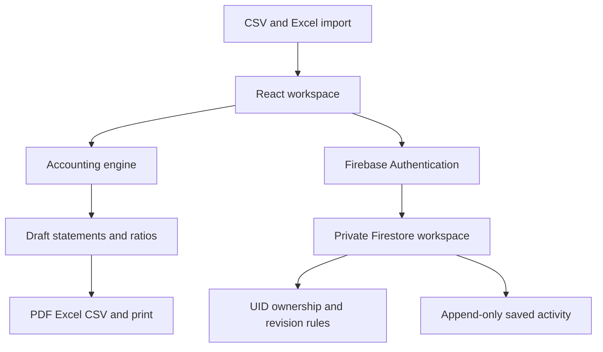

# FinStatement Pro

[Live synthetic demo](https://j-kavindu.github.io/finstatement-pro/) · [Source repository](https://github.com/j-kavindu/finstatement-pro) · [CI and deployment](https://github.com/j-kavindu/finstatement-pro/actions)

GitHub Pages deploys the public, in-memory synthetic demo from `.github/workflows/pages.yml`. Firebase configuration is not included; online persistence requires a separately configured Firebase project.

An **Accounting and Financial Reporting portfolio project** by Kavindu Heshan Jayawardhana — Accounting Undergraduate, University of Sri Jayewardenepura, and CA Sri Lanka student.

FinStatement Pro turns a classified trial balance and reviewed adjusting journals into draft financial statements and financial analysis. It demonstrates how accounting controls, reconciliation and transparent reporting can be implemented in a practical financial workspace.

> Portfolio MVP, not a certified statutory reporting or production accounting system. Reports remain **DRAFT**, even when mathematical checks pass. Live authentication and deployed Firestore rules still require verification in your own Firebase project.

## Problem statement

Preparing reports from spreadsheets often creates disconnected calculations, inconsistent account classification and weak reconciliation. This project brings trial balance import, adjusting journals, statements and ratio analysis into one reviewable workflow while making missing inputs visible.

## Features

- Dark navy dashboard, responsive sidebar and accessible financial snapshot chart controls.
- Manual trial balance editing and CSV/XLS/XLSX import with column mapping.
- Strict import validation: malformed numbers, negative amounts, unknown classifications and duplicate codes are rejected.
- Posted journals validated from actual lines, not cached flags; unknown accounts and unbalanced entries rejected.
- Accrual, prepayment and depreciation examples; contra accounts retain their accounting signs.
- Draft profit or loss, financial position, changes in equity and restricted indirect cash flow reports.
- Cash flow requires comparative reconciled balances and explicitly confirmed supplementary movements.
- Equity movement editor and reconciliation warning; movements must already be posted to the ledger.
- Ratios retain numerical precision until formatting; denominators guarded.
- PDF executive packet, six-sheet Excel workbook, CSV export and print styles.
- Google and email/password Firebase authentication helpers.
- Manual private Firestore workspace saving, revision conflict detection and account isolation by authenticated UID.
- Company/period-specific ledgers and report milestone summaries.
- Saved activity records copied to an append-only Firestore audit collection.
- Synthetic transaction register, import-ready CSV and automated tests.

## Screenshots

Browser screenshots are not included because Chromium installation failed in the audit environment. No mock screenshot is represented as a verified UI capture. On a machine with Chromium, run `npx playwright install chromium`, build the app and run `npm run test:ui` to produce `docs/dashboard.png` and `docs/mobile.png`.

## Technology stack

React 19, TypeScript with strict checking, Vite 8, Tailwind CSS 4, Firebase Authentication and Firestore, SheetJS CE 0.20.3, jsPDF/AutoTable, Lucide, Node's test runner and Playwright. SheetJS is vendored from its official distribution to avoid the vulnerable older npm release. Its upstream license is inside the vendored archive. The gRPC dependency is overridden to a patched compatible release.

## Architecture



`src/services/accountingEngine.ts` holds pure accounting functions. `App.tsx` coordinates companies, periods and ledger state. Authentication and cloud persistence are in `firebase.ts`. Import/export services are separate from UI components.

### Actual database model

- `/users/{uid}/workspaces/primary`: `payload`, `revision`, server `updatedAt`. Payload contains companies, periods, active ledger, comparative data, journal adjustments, report milestone summaries and company/period ledger map.
- `/users/{uid}/auditLogs/{id}`: append-only activity record with actor UID and server-recorded timestamp.
- Other document paths are denied. The previous unused `/companies` blueprint was removed rather than claiming a normalized database that the UI does not use.

The workspace is a small MVP aggregate capped at 900 KB of serialized payload before saving. It is not a scalable substitute for a normalized journal database. **No financial data is persisted in localStorage.** Guests work only in memory. Signed-in users must click **Save cloud workspace**; unsaved changes can be lost on reload/logout.

## Installation

Use Node.js 22.12+ or 24 LTS and npm. On Windows 11, extract the ZIP, open the folder containing `package.json`, and run:

```bash
npm ci
npm run dev
```

An unconfigured installation opens the synthetic in-memory demo. The browser suite test command uses `node --import tsx` rather than the tsx CLI, avoiding its IPC pipe restriction in constrained runtimes.

## Firebase configuration

1. Create your own Firebase project and register a web app.
2. Create a **default** Firestore database.
3. Enable Google and Email/Password in Authentication.
4. Add localhost and your intended hosting domains to Authentication authorized domains.
5. Copy `.env.example` to `.env.local` and set the real Firebase web config.
6. Copy `.firebaserc.example` to `.firebaserc` and set the project ID.
7. Deploy the supplied rules to your project and test them before confidential use.

Firebase web API keys identify the project; they are not server secrets. Never put service-account credentials, private keys or privileged tokens in `VITE_*` variables. Those variables are embedded in public browser JavaScript.

Login loads your private workspace. Use **Save cloud workspace** after edits. A transaction checks the expected revision before overwriting, preventing silent multi-session lost updates. Save errors and loading states are shown in the workspace. Only the newest 100 active-period activity entries are copied during each save; see limitations below.

## Accounting methodology

- Two-decimal monetary inputs are rounded symmetrically and sums use integer cents where implemented. Values beyond JavaScript safe monetary range are rejected. This is a bounded two-decimal MVP, not an arbitrary precision general ledger.
- Trial balances are pre-closing balances: income/expense accounts remain open; equity already contains posted capital/dividend movements. Current period profit is added once to balance sheet equity.
- Debits and credits net per account. Contra classification documents the nature of the account; the debit/credit sign determines its contribution.
- Revenue and other income are separated so gross margins are not inflated by other income.
- Adjusting journals require known accounts, valid non-negative lines, at least two lines and positive equal line totals. Posted UI entries are locked; create a reversing journal to correct them.
- Accruals, insurance consumption and depreciation are posted through reviewed journals. Revenue recognition and depreciation schedules are **not automatically determined** from contracts or asset registers.
- Equity opening balances and movements are provided explicitly; name-based fallback remains a draft estimate with a warning. OCI and other reserves enter the equity total. Users must post the corresponding journal treatment separately.
- Cash flows require comparative balances and supplementary data. This MVP uses conventional account-name matching for working capital and cash, and an operating classification for interest/tax cash payments. It cannot establish a complete IAS 7 statement for arbitrary entities. Noncash transactions, FX effects, restricted cash, leases and acquisitions need specialist treatment.
- Ratios use closing assets/equity, rather than averages. Benchmarks are illustrative, not industry conclusions.
- Reconciliation is a mathematical check, **not** an audit opinion, validation of source records, or IFRS/SLFRS compliance certification. IFRS 18 presentation and related IAS 7 amendments are not implemented.

### Synthetic example

The sample is generated from explicit balanced transaction postings, with a closed comparative balance sheet and three year-end adjustments. It has revenue USD 200,000, net profit USD 35,000, assets USD 269,000, liabilities USD 57,000 and equity USD 212,000. Operating cash flow is USD 35,000 and closing cash is USD 100,000. See `examples/transactions.json`, `trial-balance.csv`, `adjustments.json` and `expected-results.json`.

## Tests

```bash
npm run typecheck
npm test
npm run test:browser-suite
npm run build
node --import tsx tests/generate-examples.ts
```

Rules tests require **Java 21+**:

```bash
npm run test:rules
```

UI smoke tests require installed Chromium:

```bash
npx playwright install chromium
npm run build
npm run test:ui
```

Actual audit-run results and limitations are in `TEST-RESULTS.md`; raw outputs are supplied in `TEST-*.txt`. No emulator or browser interaction test is reported as passed. The included GitHub Actions workflow repeats checks without deploying.

## Deployment

Firebase Hosting is the preferred target. Full steps are in `DEPLOYMENT.md`. This ZIP includes a verified build but it contains **no live Firebase project credentials**; rebuild with your real config before hosting a cloud-enabled app.

GitHub Pages is suitable for a static synthetic demo. Set `VITE_BASE_PATH=/finstatement-pro/` while building, and publish `dist`. Firebase remains the database/auth backend if configured; Pages itself does not provide authentication or a database. Add `j-kavindu.github.io` as an authorized Firebase domain if enabling cloud sign-in.

No repository has been created/overwritten and no application has been publicly deployed. Suggested repository: `j-kavindu/finstatement-pro`.

## Security

Default-deny Firestore rules restrict all workspace/audit access to the authenticated UID. Server timestamps and monotonic revisions are checked. Audit documents reject update/delete. Workspace contents and report milestone summaries remain owner-editable; rules do not recompute journal lines inside the aggregate. Do not present this as a tamper-proof regulated ledger.

CSV exports escape quotes and neutralize formula prefixes. File imports have a 5 MB limit. Error messages do not dump the user's email/provider metadata. Production audit reported zero known dependency vulnerabilities in this run; development tooling still has advisories listed in the audit report. Security scans are snapshots, not guarantees.

## Known limitations and roadmap

- Verify real Google/email login, logout/login restoration and deployed rules before real use.
- Complete browser/mobile/accessibility testing and screenshots; modal focus trapping remains future work.
- Move to normalized company/period/journal collections with server-side posting and full immutable report snapshots.
- Add explicit cash-flow account tags and complete working capital/noncash/FX treatment.
- Add asset registers, contractual revenue recognition, inventory valuation and statutory disclosures.
- Add complete OCI/reserve column layouts, opening balance import, full prior P&L comparisons and multiuser permissions.
- Add unsaved-change prompts, automatic save queue and pagination of audit history.
- Reduce large initial bundle and remediate development-toolchain advisories.
- Light theme is not implemented; the existing navy design is preserved.

## Author and license

**Kavindu Heshan Jayawardhana** · Accounting Undergraduate, University of Sri Jayewardenepura · CA Sri Lanka Student.

GitHub: [j-kavindu](https://github.com/j-kavindu) · LinkedIn: [jkavindu](https://www.linkedin.com/in/jkavindu/)

MIT License. See `LICENSE`; third-party dependencies retain their own licenses.

## Primary references used during the audit

- [Firebase rules testing](https://firebase.google.com/docs/firestore/security/test-rules-emulator)
- [SheetJS official installation/distribution](https://docs.sheetjs.com/docs/getting-started/installation/frameworks/)
- [IFRS Foundation: IAS 7](https://www.ifrs.org/issued-standards/list-of-standards/ias-7-statement-of-cash-flows.html)
