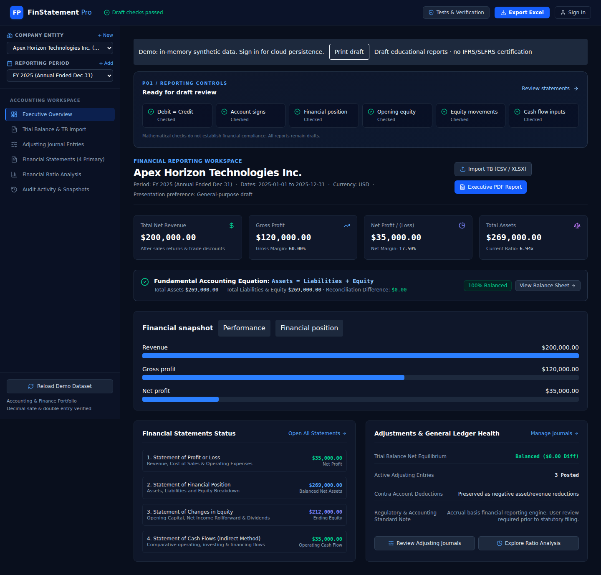

# FinStatement Pro · P01

[Live synthetic demo](https://j-kavindu.github.io/finstatement-pro/) · [Source](https://github.com/j-kavindu/finstatement-pro) · [Deployment guide](DEPLOYMENT.md) · [Architecture & data model](docs/ARCHITECTURE.md)

An automated draft financial statement generator by **Kavindu Heshan Jayawardhana**. P01 improves the existing FinStatement Pro project: import a trial balance, map accounts, post adjusting journals, reconcile equity and export reviewable reports.

**All examples are synthetic. Mathematical reconciliation is not financial compliance, an audit opinion or a statutory reporting certification.** Firebase configuration is optional; the public demo works in memory and discards changes on reload.

## Run locally

Node.js 22.12+ or 24 LTS and npm:

```bash
npm ci
npm run dev
```

Open `http://localhost:3000`. No account or Firebase project is needed for the synthetic demo. For Windows, run these commands in PowerShell from the folder containing `package.json`.

## MVP workflow

1. **Trial Balance**: import CSV/XLSX (first worksheet, maximum 5 MB and 5,000 rows), or enter balances manually. Download the included CSV template or use `examples/trial-balance.csv`.
2. **Chart of Accounts mapping**: select source columns, review per-account classifications and contra flags. Existing codes retain their IDs so posted journals stay linked. New unknown codes require an explicit classification.
3. **Adjustments**: create balanced journal lines, save drafts and post reviewed entries. Only posted journals affect reports. Posted entries are locked; corrections require another journal.
4. **Statements**: review Profit or Loss, Financial Position and Changes in Equity, including reserves/OCI. Enter explicit opening equity and movements. Capital/dividend/OCI movements must already be reflected in the ledger; this form does not post them a second time.
5. **Controls**: inspect debit/credit equality, account signs, position reconciliation, opening equity, equity rollforward and cash-flow prerequisites.
6. **Exports**: download the seven-sheet Excel workbook, executive PDF with reporting controls, trial balance CSV or print a draft. PDF/XLSX statement packets block on missing opening equity, imbalance or equity mismatch.

Imports replace the current period's **unadjusted** balances and preserve existing posted journals. They do not append journal transactions or automatically establish opening balances. Missing accounts referenced by posted journals prevent replacement. Invalid or unbalanced imports stay in preview.

## Screenshots

These are actual Chromium captures of synthetic data from the tested production build.



[Mobile dashboard](docs/mobile.png) · [Import and mapping](docs/import-mapping.png) · [Journals](docs/journals.png) · [Equity statement](docs/equity.png)

## Accounting rules

- **decimal.js 10.6.0** performs monetary addition/subtraction with 40-digit internal precision and ROUND_HALF_UP. Money is normalized to two decimals. Individual inputs and computed totals are bounded to ±1 trillion; JSON retains number fields for compatibility with existing workspaces. Ratios are not monetary amounts and use ordinary division.
- Trial balance and journal debit/credit amounts must be non-negative, finite, within range and have at most two decimals. Import explicitly rounds finer decimal inputs and displays a warning. Malformed numbers, missing mappings and duplicate codes are rejected.
- Account category plus debit/credit sign determines presentation. Contra flags document normal balance expectations and trigger unusual-sign review; they never force an absolute amount or double-negate a balance.
- The ledger uses a **pre-closing** convention: income/expense accounts remain open. Current profit is added to position equity once. Do not import a post-closing ledger and also add its historical profit as current income.
- Opening equity total is compared with the prior period's closing equity when available. Without prior data the UI gives a manual-opening warning; it never invents comparative evidence. Components still require review.
- Opening equity + profit + capital issued − dividends declared + OCI must equal closing position equity. Other-reserve columns are shown explicitly.
- Cash flow requires reconciled comparative balances and complete supplementary movements. The inherited indirect model uses conventional account-name matching for cash/working capital and an operating policy for interest/tax. A cash reconciliation warning remains visible when the result differs. It is not a complete general-purpose IAS 7 implementation.
- Journal dates and period ownership, duplicate journal IDs, actual line totals and account references are checked. Cached `isBalanced` flags are not trusted.

## Synthetic benchmark

| Metric | USD |
|---|---:|
| Revenue | 200,000.00 |
| Net profit | 35,000.00 |
| Total assets | 269,000.00 |
| Total liabilities | 57,000.00 |
| Opening equity | 182,000.00 |
| Closing equity | 212,000.00 |
| Operating cash flow | 35,000.00 |
| Closing cash | 100,000.00 |

`examples/` contains the CSV, transaction register, adjusting journals, opening equity, cash movement inputs, expected results and generated XLSX/PDF. `tests/generate-examples.ts` regenerates them from the synthetic ledger.

## Architecture and Firebase

React + TypeScript + Vite + Tailwind, decimal.js, Firebase Authentication/Firestore, vendored SheetJS CE 0.20.3, jsPDF and Playwright.

The accounting engine is pure and independent of Firebase. The UI coordinates company/period ledgers and validation. Imports and exports use separate services. See [the architecture document](docs/ARCHITECTURE.md) for schema, invariants and trust boundaries.

Firebase is **not configured in the public deployment**. To enable it, follow [DEPLOYMENT.md](DEPLOYMENT.md), using `.env.example`, `.firebaserc.example`, `firebase.json` and `firestore.rules`. Never put privileged credentials in `VITE_*` variables.

Signed-in users explicitly save a private `/users/{uid}/workspaces/primary` aggregate. Revision checks prevent a stale save from overwriting a newer session. Saved activity is copied to append-only `/users/{uid}/auditLogs/{id}` documents. Default-deny rules enforce ownership. The 900 KB client payload limit keeps this an MVP, not a large-company ledger. No financial workspace is stored in localStorage.

## Verification

```bash
npm run typecheck
npm test
npm run test:browser-suite
npm run build
npx playwright install chromium
npm run test:ui
node --import tsx tests/generate-examples.ts
```

`test:browser-suite` runs the existing 12 engine scenarios under Node; it is not a browser automation test. `test:ui` uses Chromium for actual imports, rejection, journal preservation, equity export gates, downloads, period switching and five responsive widths. It saves screenshots in `docs/`.

Firestore rules tests require Java 21+:

```bash
npm run test:rules
```

See [TEST-RESULTS.md](TEST-RESULTS.md) for executed results and environment limitations. `.github/workflows/pages.yml` verifies types/tests/build before Pages deployment; `verify.yml` additionally runs emulator and browser checks.

## Limits

- Draft reporting only: no tax filing, statutory disclosures, consolidation, automatic depreciation/revenue schedules or independently verified IFRS/SLFRS compliance.
- No multiuser collaboration, server-side posting, immutable financial history or automatic backup. Owner-editable workspace data is not a tamper-proof journal system.
- Real Firebase login, account isolation and restore must be accepted against your own deployed Firebase project. Emulator tests do not establish live production behavior.
- Cash-flow name matching does not fully support noncash acquisitions, FX, leases, restricted cash or arbitrary custom accounts. Review those manually.
- Currency is presentation only, with a two-decimal convention; no FX conversion or special minor-unit rules.
- Only the first Excel worksheet is imported. Very large/compressed workbooks need a worker/server import pipeline.
- A large initial JS bundle remains; later work can split import/export libraries. Modal focus trapping remains a known accessibility improvement.
- Prior audit files describe an older baseline. Current P01 implementation and verification are documented here and in TEST-RESULTS.md.

MIT License. Third-party packages retain their own licenses. [decimal.js arithmetic reference](https://mikemcl.github.io/decimal.js/) · [Firebase rules testing](https://firebase.google.com/docs/firestore/security/test-rules-emulator).
