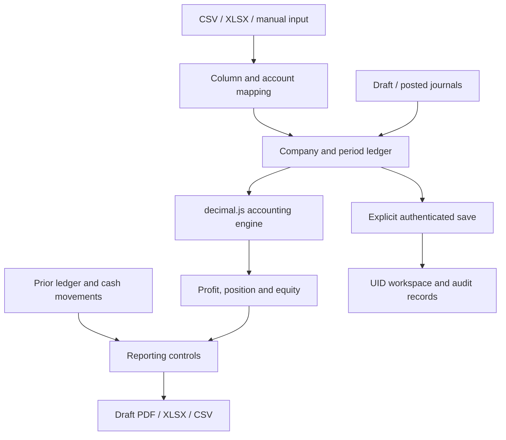

# P01 architecture and data model

This extends the existing FinStatement Pro codebase. Existing numeric monetary fields, account IDs and Firebase workspace paths are retained; no destructive database migration is required.

## Source ownership

| File | Responsibility |
|---|---|
| `src/types/accounting.ts` | TypeScript domain types and versioned aggregate |
| `src/services/money.ts` | Decimal normalization, exact sums, range and precision checks |
| `src/services/accountingEngine.ts` | Pure trial balance, journal, statement and ratio functions |
| `src/services/importService.ts` | File parsing, column detection, explicit classification and account identity reuse |
| `src/services/reportValidation.ts` | Six review controls and statement export gate |
| `src/services/workspaceValidation.ts` | Validate all loaded ledgers before React state updates |
| `src/services/exportService.ts` | CSV, seven-sheet workbook and PDF packet; service-level reconciliation guards |
| `src/services/firebase.ts` | Auth, explicit save/load, revision transaction and saved audit activity |
| `src/App.tsx` | Workspace orchestration, isolated company/period state and mutation validation |

## Entities

| Entity | Important fields | Invariants |
|---|---|---|
| Company | `id`, `ownerId`, `name`, `currency`, `reportingFramework` | Currency is an uppercase three-letter display code; framework is a preference, not a compliance finding |
| ReportingPeriod | `id`, `companyId`, `startDate`, `endDate`, `status`, `comparativePeriodId?` | Prior period precedes current period and belongs to same company; closed periods cannot be edited in UI |
| TrialBalanceRow / account map | `id`, `accountId`, `accountCode`, `accountName`, `classification`, `isContra`, unadjusted debit/credit | Code is unique case-insensitively; account ID stable on re-import; debit or credit only |
| AdjustingJournalEntry | `id`, `periodId`, `entryNumber`, `date`, `description`, `lines`, `status` | Actual posted lines balance; known accounts; no duplicate entry IDs; dates within period |
| JournalLine | `id`, `accountId`, `debit`, `credit`, `memo` | Valid bounded two-decimal numbers; no simultaneous debit and credit |
| EquityMovementData | opening capital, retained earnings, reserves, issuance, dividends, OCI | Explicit input; opening reconciles to prior total; closing reconciles to ledger plus profit |
| SupplementaryCashFlowData | noncash adjustments and cash financing/investing/tax/interest movements | Required with comparative balances; not inferred from a single trial balance |
| LedgerWorkspace | trial balance, adjustments, comparative rows, equity, supplementary data, logs, snapshots | Stored by `companyId:periodId` |
| WorkspacePayload | `schemaVersion: 1`, companies, periods, selected entities, active ledger, ledgers map | Missing schemaVersion accepted as legacy v1; unsupported versions rejected |

`AccountDefinition` remains an available domain type, but the active MVP chart is embedded in period trial balance rows. It is not a separately persisted organization-wide chart table. Re-import matches chart codes; mapping decisions persist when the workspace is saved.

## Monetary contract

Money enters the engine as bounded, two-decimal numbers. decimal.js clones an isolated constructor with 40 significant digits and ROUND_HALF_UP. Arithmetic converts validated operands to Decimal **before** addition/subtraction and returns normalized numbers for React, JSON and legacy compatibility. Magnitudes above 1,000,000,000,000 are rejected. CSV strings are parsed directly before rounding; inputs rounded from finer precision produce a preview warning. Financial ratios use ordinary division and are rounded only for display.

## Calculation order

1. Validate trial balance row identity, classifications, precision and sign.
2. Validate posted journals from their lines and apply them exactly once.
3. Recompute adjusted debit/credit and check exact zero difference.
4. Produce profit or loss; separate other income from sales revenue.
5. Produce financial position, adding current-period profit to pre-closing equity once.
6. Produce explicit equity rollforward with reserve/OCI columns.
7. Compare opening total with comparative closing equity; flag missing prior evidence.
8. Build conditional indirect cash flow and compare calculated/ledger cash.
9. Export draft packets only after blocking controls are resolved. Unusual signs and absent cash-flow prerequisites remain review warnings, allowing non-cash-flow statements.

## Storage and trust boundary

`/users/{uid}/workspaces/primary` stores `{payload, revision, updatedAt}`. `payload` contains the typed aggregate; `revision` increments transactionally. `/users/{uid}/auditLogs/{id}` stores saved activity with actor ID/server timestamp. Other paths are denied. The client validates loaded data before state replacement, including inactive ledgers. Authentication and Firestore rules govern private ownership; UI accounting checks are **not** a substitute for server-side posting validation.

Guests use synthetic in-memory state. There is no automatic save or financial localStorage persistence. Existing credentials are not included. Explicit save has a 900 KB payload limit and copies up to the newest 100 active-period activity events; report snapshots are milestone summaries, not full immutable source snapshots.

## Future evolution

Normalize company/period/account/journal collections; perform immutable journal posting and report generation on a trusted server; add explicit cash-flow account tags; implement opening equity component reconciliation; add backups and full statement version snapshots. These are future work, not features claimed by P01.
